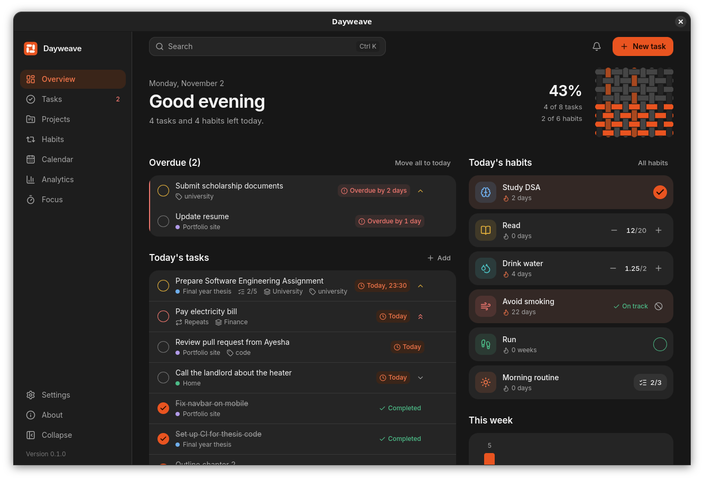
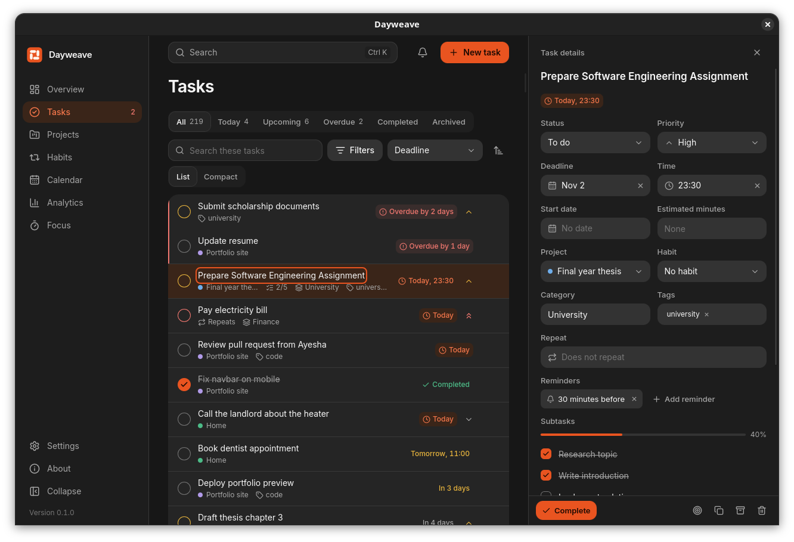
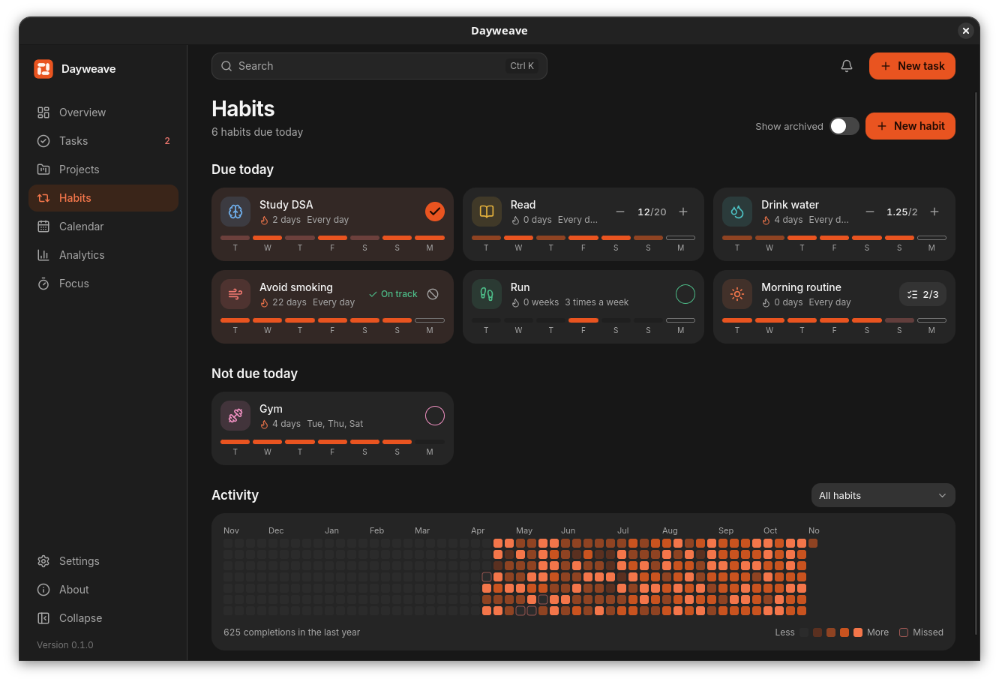
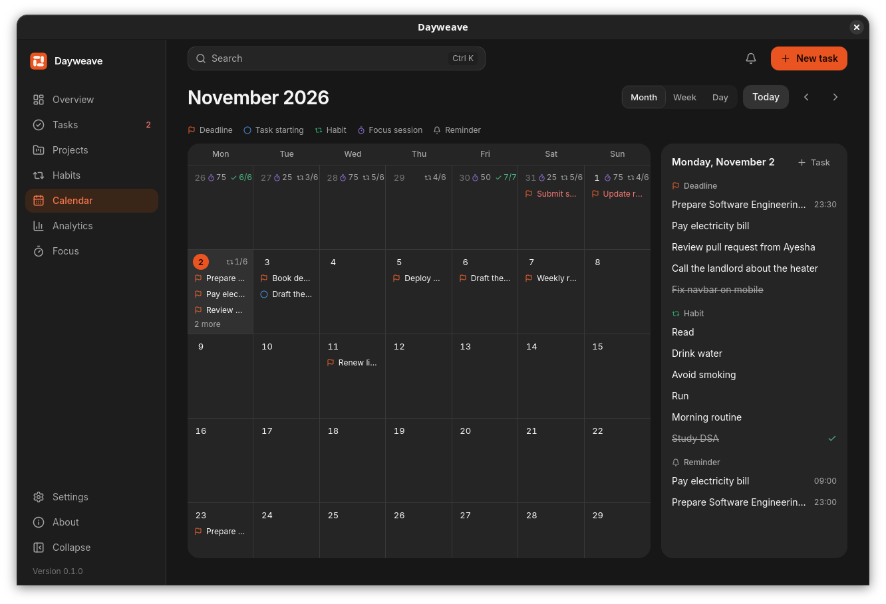
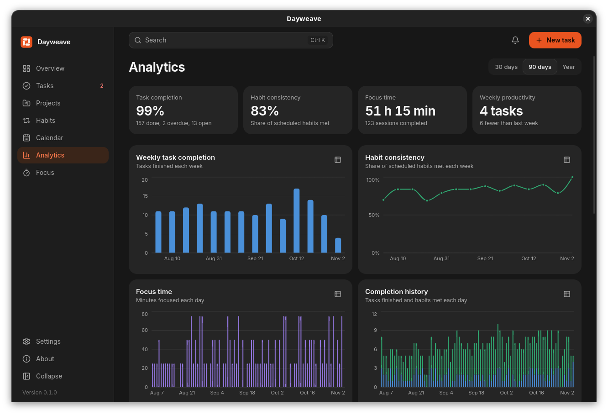
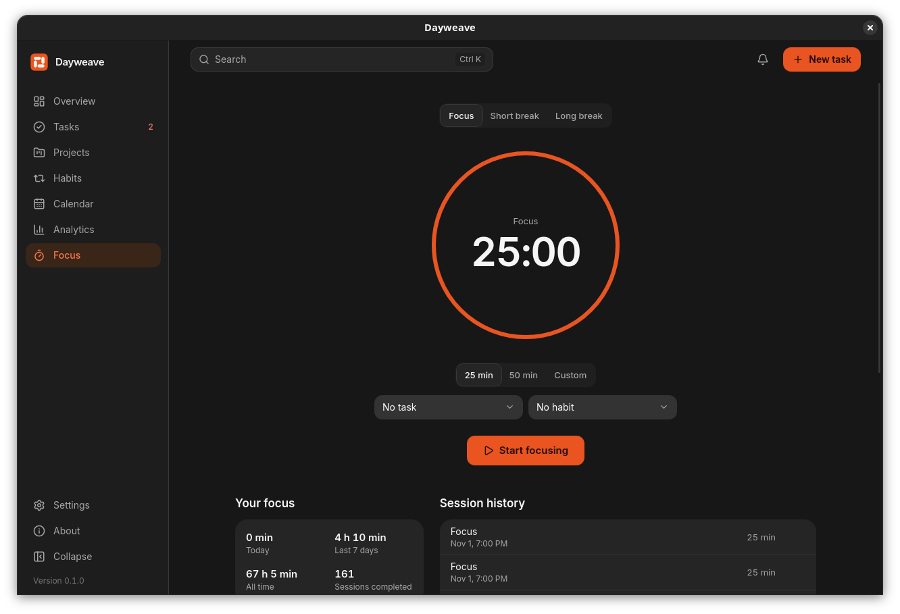
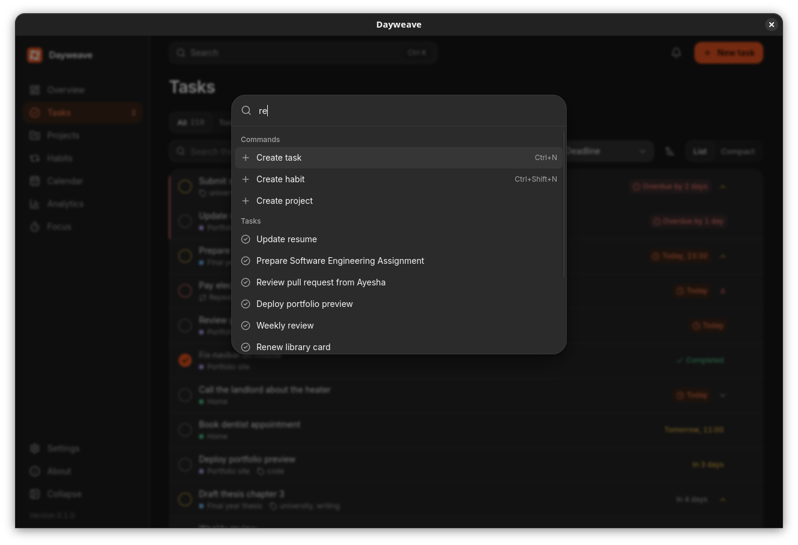
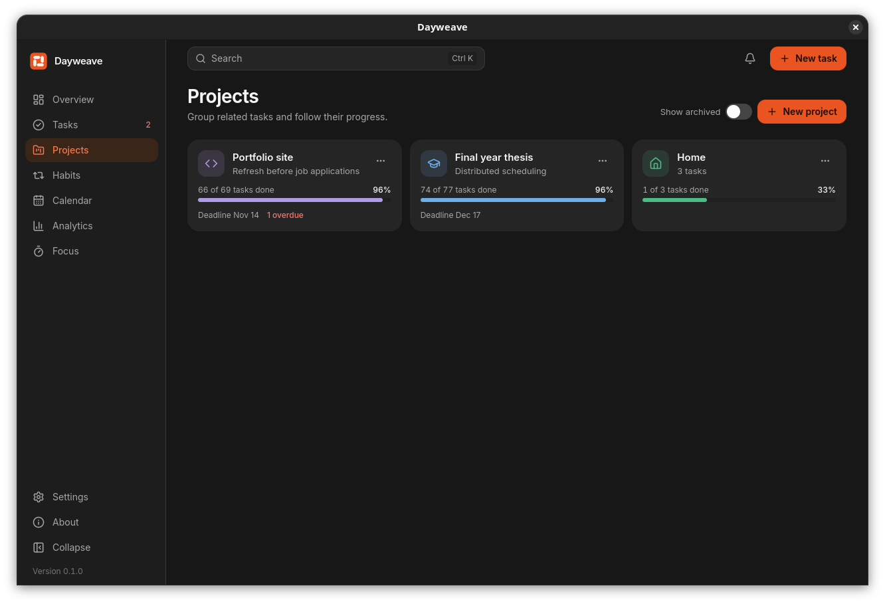
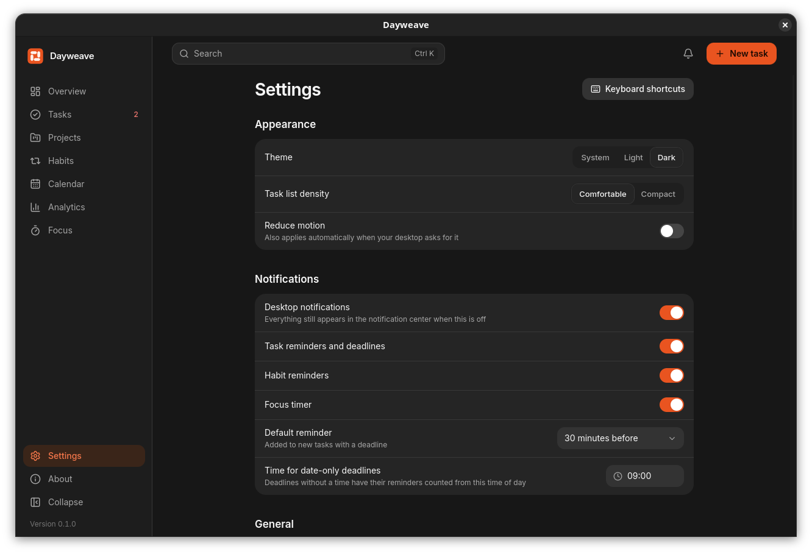

# Dayweave

**Build better days, one habit at a time.**

Tasks, deadlines, habits, a calendar, focus sessions and analytics, together in one private
application for Ubuntu. Everything stays on your computer.

<picture>
  <source media="(prefers-color-scheme: dark)" srcset="docs/screenshots/overview-dark.png">
  <source media="(prefers-color-scheme: light)" srcset="docs/screenshots/overview-light.png">
  
</picture>

## Your day, as a piece of cloth

In weaving, the warp threads stay fixed on the loom and the weft passes through them. A day works
the same way: habits are the threads that stay, and tasks are what passes through. The Overview
draws today as a small piece of weave, and each thread fills with colour as you finish it.

## Features

### Tasks and deadlines

- Priorities, statuses, categories, tags, nested subtasks and estimates
- Date-only or exact deadlines, described honestly: "Today" for a date, "In 10 min" for a time
- Several reminders per task, and repeating tasks with custom rules
- A dedicated overdue view, with rescheduling one task at a time or all at once
- Filters, search, sorting, and list or compact views

<picture>
  <source media="(prefers-color-scheme: dark)" srcset="docs/screenshots/task-details-dark.png">
  <source media="(prefers-color-scheme: light)" srcset="docs/screenshots/task-details-light.png">
  
</picture>

### Habits

- Four kinds: habits to build, habits to quit, amounts to reach, and checklists
- Every day, chosen days, or a number of times a week
- Streaks that respect the schedule, so a day off is not a missed day
- A year-long activity heatmap and a month-by-month history

<picture>
  <source media="(prefers-color-scheme: dark)" srcset="docs/screenshots/habits-dark.png">
  <source media="(prefers-color-scheme: light)" srcset="docs/screenshots/habits-light.png">
  
</picture>

### Calendar

Month, week and day views bring deadlines, tasks, habits, focus sessions and reminders together.
Drag a deadline to another day to move it.

<picture>
  <source media="(prefers-color-scheme: dark)" srcset="docs/screenshots/calendar-dark.png">
  <source media="(prefers-color-scheme: light)" srcset="docs/screenshots/calendar-light.png">
  
</picture>

### Analytics

Task completion, habit consistency, focus time and project progress. Every chart can also be read
as a table.

<picture>
  <source media="(prefers-color-scheme: dark)" srcset="docs/screenshots/analytics-dark.png">
  <source media="(prefers-color-scheme: light)" srcset="docs/screenshots/analytics-light.png">
  
</picture>

### Everything else

| | |
| --- | --- |
| <picture><source media="(prefers-color-scheme: dark)" srcset="docs/screenshots/focus-dark.png"><source media="(prefers-color-scheme: light)" srcset="docs/screenshots/focus-light.png"></picture> | <picture><source media="(prefers-color-scheme: dark)" srcset="docs/screenshots/command-palette-dark.png"><source media="(prefers-color-scheme: light)" srcset="docs/screenshots/command-palette-light.png"></picture> |
| **Focus sessions.** A distraction-free timer with breaks, linked to a task or habit | **Command palette.** Ctrl+K reaches every action, task, habit and project |
| <picture><source media="(prefers-color-scheme: dark)" srcset="docs/screenshots/projects-dark.png"><source media="(prefers-color-scheme: light)" srcset="docs/screenshots/projects-light.png"></picture> | <picture><source media="(prefers-color-scheme: dark)" srcset="docs/screenshots/settings-dark.png"><source media="(prefers-color-scheme: light)" srcset="docs/screenshots/settings-light.png"></picture> |
| **Projects.** Group tasks and follow their progress | **Settings.** Light, dark and system themes, notifications and backups |

## Reminders

Dayweave delivers reminders as desktop notifications, with buttons to complete or snooze a task
right from the notification.

Reminders work while Dayweave is running, including with its window closed, because closing the
window leaves it waiting in the tray. **Quit stops them.** Anything missed is delivered the next
time Dayweave starts. To have reminders from the moment you sign in, turn on **Start at login** in
Settings.

## Privacy

Dayweave has no account, no cloud service, no telemetry and no advertising. It makes no network
requests, and the snap doesn't even have permission to. Your data is one SQLite file on your
computer. See [PRIVACY.md](PRIVACY.md).

## Install

See [INSTALLATION.md](INSTALLATION.md) for the snap, `.deb` and AppImage.

## Keyboard shortcuts

| Keys | Action |
| --- | --- |
| Ctrl+K | Command palette |
| / | Search |
| Ctrl+N | New task |
| Ctrl+Shift+N | New habit |
| Ctrl+1 to 7 | Go to a page |
| J, K | Move through tasks |
| X | Complete the selected task |
| Ctrl+B | Collapse the sidebar |
| F1 | All shortcuts |

## Built with

Tauri 2, Rust and SQLite behind a React and TypeScript interface. Dayweave is a Tauri application
that fits in on Ubuntu, not a native GTK or Libadwaita one.

- [ARCHITECTURE.md](ARCHITECTURE.md) explains how it works and why
- [DEVELOPMENT.md](DEVELOPMENT.md) covers building, testing and releasing
- [docs/DESIGN.md](docs/DESIGN.md) describes the design system
- [docs/VERIFICATION.md](docs/VERIFICATION.md) records what has actually been tested

## License

[MIT](LICENSE)
